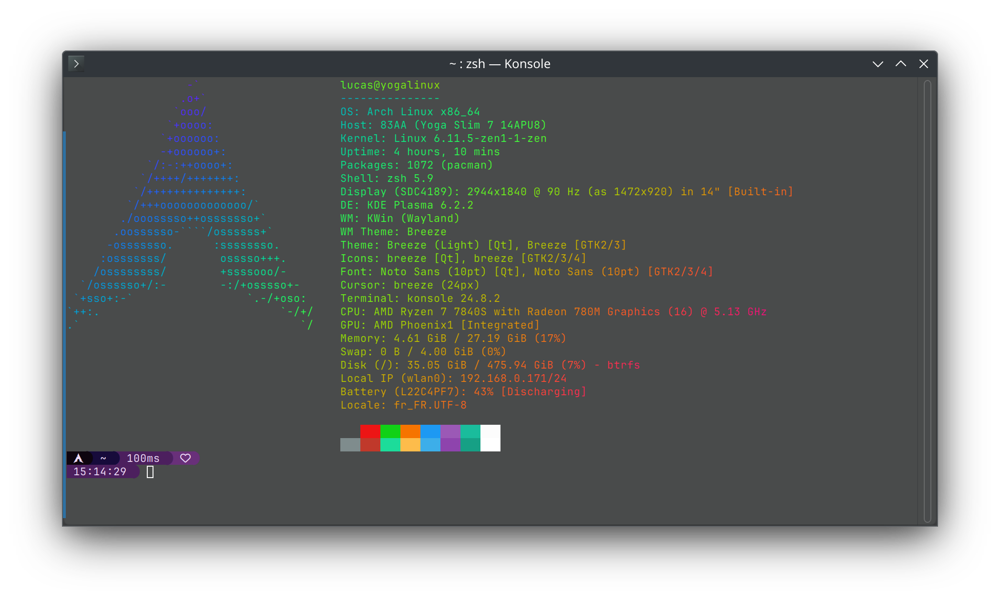

# Configuration for Arch Linux



## Fixing suspend

Use the **[mkinitcpio's acpi_override hook](https://wiki.archlinux.org/title/DSDT#Using_mkinitcpio's_acpi_override_hook)** to override the ACPI table :

```bash
sudo mkdir /etc/initcpio/acpi_override
sudo cp ssdt6.aml /etc/initcpio/acpi_override/
```

then edit `/etc/mkinitcpio.conf` and add `acpi_override` to the `HOOKS` array.

```conf
HOOKS=(... acpi_override)
```

Then rebuild the initramfs with `sudo mkinitcpio -P` and reboot.

> Note : if after reboot suspend is still not working properly, disable secure boot in BIOS settings.

## Fixing sound

You need to install the custom firmware to get sound working properly.

```bash
# Backup existing firmware files if exist
sudo cp /lib/firmware/TAS2XXX38BB.bin /lib/firmware/TAS2XXX38BB.bin.bak
sudo cp /lib/firmware/TIAS2781RCA4.bin /lib/firmware/TIAS2781RCA4.bin.bak

# Install custom firmware
git clone https://github.com/darinpp/yoga-slim-7.git
cd yoga-slim-7
sudo cp ./lib/firmware/TAS2XXX38BB.bin /lib/firmware/
sudo cp ./lib/firmware/TIAS2781RCA4.bin /lib/firmware/
```

Then reboot your system.

## Power profiles

On an Arch installation don't forget to install `power-profiles-daemon` to get control over power profiles.
