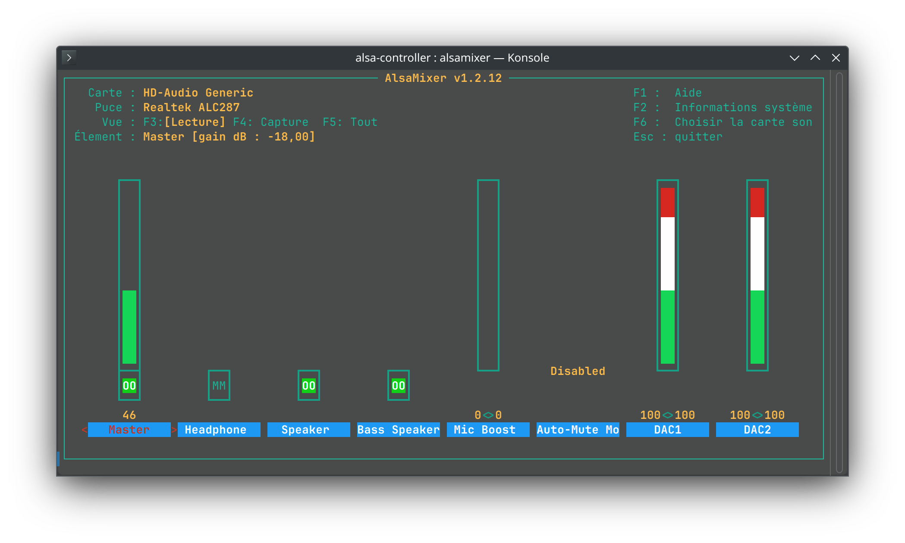

# Sound Improvement

You can use `alsamixer` to adjust the sound levels of the subwoofers and the main speakers (DAC 1 & 2).

Sound will not be as good as on Windows (the 4 subwoofers are not calibrated precisely and Dolby Atmos spacial effect is missing.)

However, you can mitigate this with [Easy Effects](https://github.com/wwmm/easyeffects).
There is a preset that I made to improve the sound in the `easyeffect` folder (I'm not an expert so if you want to make a better one, do not forget to share it :) )
