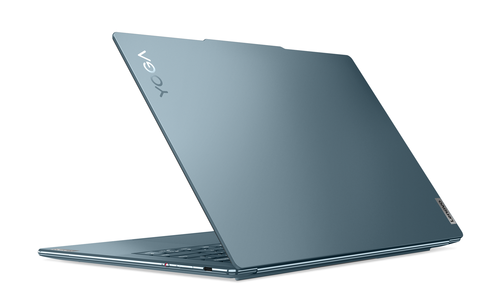

# Lenovo Yoga Slim 7 (14APU8) Linux

All-in-one guide to get your Lenovo Yoga Slim 7 14APU8 working properly on Linux.

**Last update : 07/12/2025 (BIOS `M6CN44WW`)**

## Compatibility

| Component | Description | Status |
| --- | --- | --- |
| CPU | AMD Ryzen 7 7840S | ✅ Working OoB |
| GPU | AMD Radeon 780M | ✅ Working OoB |
| Memory | 16-32GB LPPDR5X | ✅ Working OoB |
| Storage | 512GB-1TB NVMe SSD | ✅ Working OoB |
| Display | 14" 2944x1840@90 OLED | ✅ Working OoB |
| WiFi | RTL8852CE | ✅ Working OoB |
| Bluetooth | RTL8852CU | ✅ Working OoB |
| Sound (Subwoofer) | TI 2781  | ✅ Working with **custom firmware** |
| Touchpad | Unknown | ✅ Working OoB |
| Camera | 720p | ✅ Working OoB |
| Suspend | - | ✅ Working with **injected SSDT** |
| Hibernate | - | ❌ Broken |
| IR Camera auth | 720p | ✅ See [Howdy](https://github.com/boltgolt/howdy)

## Setup Guides

### Distribution specific guides

- **[AIO Guide for Arch Linux](./ARCHLINUX.md)**
- **[AIO Guide for Fedora Silverblue](./SILVERBLUE.md)**

### Other fixes (applicable to all distributions)

- **[Updating the BIOS](./UPDATE_BIOS.md)**
- **[Sound Improvement](./easyeffect/README.md)**
- **[Disabling Hibernation](./HIBERNATION.md)**

### More info

- **[Suspend](./SUSPEND.md)**

## Notes

- If some updates are missing, feel free to open issues / PR.
- I'm not the maintener of the custom firmware / injected SSDT, if you have any problems related with them, open issues on their related repos.
