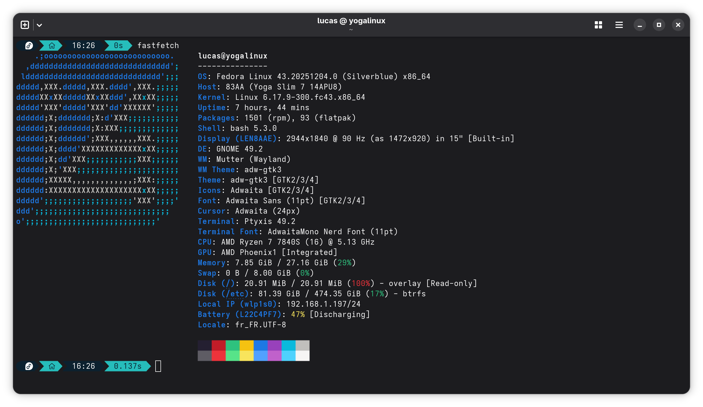

# Configuration for Fedora Silverblue

*Or any Fedora immutable based distro (kenoite, universal blue...)*



Silverblue is an immutable variant of Fedora Workstation. This guide will help you set up your Lenovo Yoga Slim 7 14APU8 on Silverblue.

Because of Silverblue's immutability, everything will be done using `rpm-ostree` to install packages and overlays to modify system files.

> For some reason, it seems that the camera is not working on Silverblue. If this is an important feature for you, please use another distro (such as Archlinux).

## Fixing Suspend

Install the ACPI override package to get suspend working properly:

```bash
rpm-ostree install RPMs/acpi-yoga-fix-2.0-1.noarch.rpm
```

Reboot your system to apply package, enable the service

```bash
sudo systemctl enable acpi-yoga.service
```

Then reboot again, and reboot again (yes 2 times !), and now check if the ACPI tables have been applied correctly with :

```bash
sudo dmesg | grep ACPI | grep "Table Upgrade"
```

You should see something like :

```bash
[    0.003464] ACPI: Table Upgrade: override [SSDT-LENOVO-    UPEP]
```

Suspend should now work properly.

> The script come with a tiny CLI to manage the ACPI override, you can check the available options with :
>
>```bash
>acpi-yoga-fix help
>```
>
>By default, the service `acpi-yoga` will check if the ACPI override is applied at each shutdown/reboot, and will re-apply it if not. You can disable this behavior with :
>
>```bash
>sudo systemctl disable acpi-yoga.service
>```

## Fixing Sound

You need to install a custom firmware for the sound card to get the subwoofer working properly.

```bash
rpm-ostree install RPMs/cfw_ti2781-1.0-1.x86_64.rpm
```

Reboot your system to apply changes.

## Hide Grub Boot Menu

Not related to hardware fixes, but if you want to hide the grub boot menu at startup, create a file in `/boot/grub2/user.cfg` with the following content:

```bash
set timeout=0
set timeout_style=hidden
```

> **Note**: If you need to access the grub menu in the future, hold the `Shift` key while booting or press `Esc` key repeatedly.
